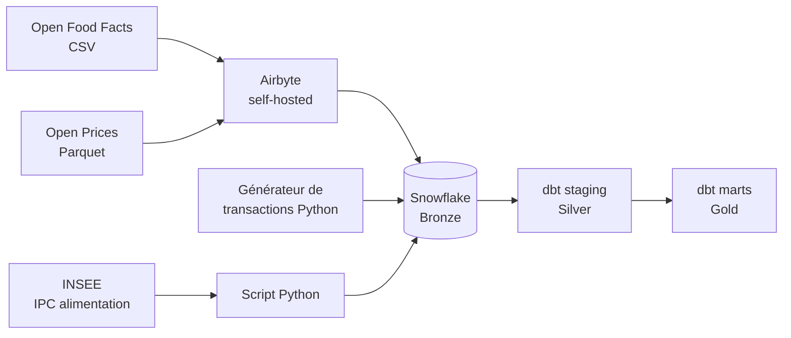

# Leclerc Analytics Engineering

Pipeline ELT de bout en bout simulant l'environnement data d'un distributeur français : ingestion de sources ouvertes, entrepôt Snowflake, transformations dbt en architecture Bronze / Silver / Gold, et marts orientés métier (segmentation client, indicateurs de vente, tendances, analyse de panier).

> **Les transactions sont synthétiques.** Leclerc n'expose aucune API publique : les transactions sont générées par un script Python qui reprend des statistiques de consommation françaises. Les écarts que cela crée sont documentés dans [`docs/decisions_architecture.md`](docs/decisions_architecture.md).

## Architecture



## Sources

| Source | Contenu | Chargement |
|---|---|---|
| Open Food Facts | catalogue produits (CSV, France filtrée en aval) | Airbyte |
| Open Prices | prix observés (Parquet, data.gouv.fr) | Airbyte |
| Transactions | 10 000 clients, environ 1,5 million de lignes, synthétiques | script Python |
| INSEE | indice des prix à la consommation, alimentation (API SDMX) | script Python |

## Ce qui est construit

- **Gouvernance Snowflake** : rôles et comptes de service dédiés par outil (moindre privilège), `snowflake/rbac_roles.sql`.
- **Taxonomie de 29 rayons**, construite empiriquement à partir de 578 000 produits (93,8 % de couverture sur les produits qui ont au moins un tag).
- **Staging dbt** : un modèle par source, avec correction du typage des codes-barres.
- **Marts Gold** (10 modèles dbt et 33 tests au total) :
  - `mart_rfm_customers` : récence, fréquence, montant et 5 segments clients ;
  - `mart_kpis_mois_rayon` et `mart_kpis_mois` : chiffre d'affaires, panier moyen, part des rayons ;
  - `mart_tendances_jour` : ventes journalières et indice INSEE, entrée prévue pour la prévision ;
  - `mart_mba_paniers` et `mart_mba_regles` : support, confiance et lift de paires d'articles, calculés en SQL.
- **Registre de décisions** : 31 décisions d'architecture avec leur contexte et leurs limites, dans `docs/decisions_architecture.md`. Le journal et les incidents rencontrés sont dans `notes/`.

## Limites connues

- Les plages d'achats par client du générateur ne ressemblent pas à des clients de supermarché : les groupes de fréquence sont nommés par volume (faible, moyenne, élevée) plutôt que par comportement.
- La hausse des transactions au fil des mois vient du générateur, pas d'une vraie tendance de consommation.
- Les prix simulés ne dépendent pas de la date : l'indice INSEE n'explique pas les ventes.
- Les codes-barres sont stockés en nombre à virgule côté Bronze, donc exacts seulement sur 15 à 17 chiffres.

## Organisation du dépôt

```
ingestion/            scripts Python (transactions, INSEE, connexion Snowflake)
snowflake/            droits (RBAC) et requêtes d'exploration
dbt/leclerc_dbt/      modèles staging et marts, macros, tests
docs/                 décisions d'architecture
notes/                journal de projet et incidents
```

## Lancer le projet

Prérequis : Python 3.12, un compte Snowflake, Airbyte (`abctl local install`).

```bash
conda create -n leclerc python=3.12
conda activate leclerc
pip install -r requirements.txt
cp .env.example .env        # puis renseigner les variables Snowflake

# 1. Dans Airbyte : synchroniser Open Food Facts et Open Prices vers Snowflake (Bronze)
# 2. Charger les deux autres sources
python ingestion/transactions_generator.py
python ingestion/insee_conjoncture_extract.py

# 3. Transformer
cd dbt/leclerc_dbt      # connexion décrite dans ~/.dbt/profiles.yml, hors dépôt
dbt run
dbt test
```

## Reste à faire

- Modèles de prévision (Prophet pour la demande, XGBoost pour les promotions)
- Orchestration Airflow
- CI/CD avec GitHub Actions (`dbt build` et tests à chaque pull request)
- Restitution : Power BI et Streamlit

## Stack

Python, SQL, Airbyte, Snowflake (Azure), dbt, Git.
