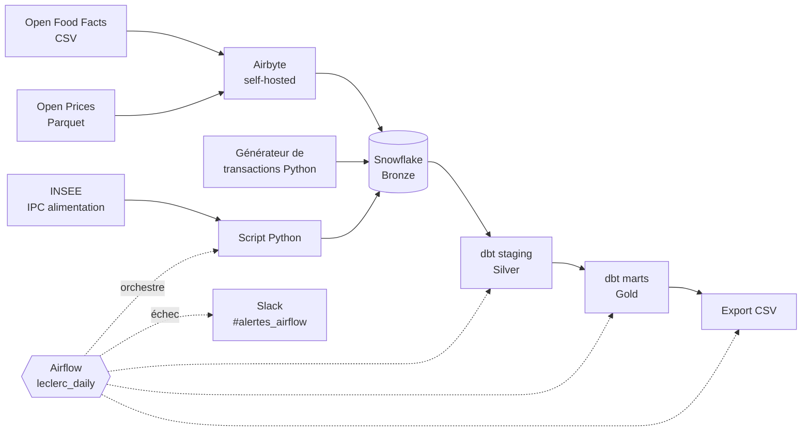
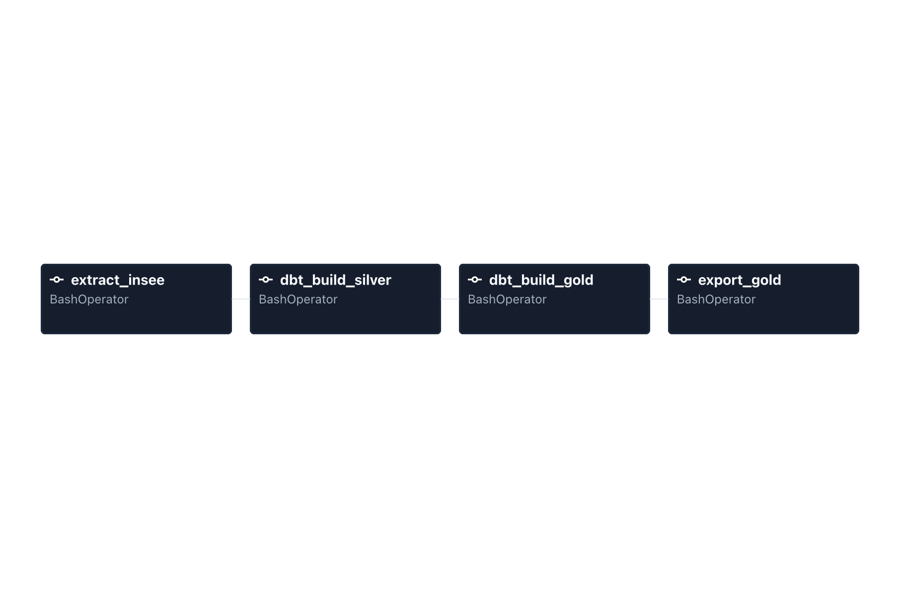

# Leclerc Analytics Engineering

[](https://github.com/bipanda93/leclerc-analytics-engineering/actions/workflows/dbt-ci.yml)
[](https://github.com/bipanda93/leclerc-analytics-engineering/actions/workflows/airflow-ci.yml)

Pipeline ELT de bout en bout simulant l'environnement data d'un distributeur français : ingestion de sources ouvertes, entrepôt Snowflake, transformations dbt en architecture Bronze / Silver / Gold, marts orientés métier (segmentation client, indicateurs de vente, tendances, analyse de panier), orchestration Airflow avec alertes Slack et intégration continue.

> **Les transactions sont synthétiques.** Leclerc n'expose aucune API publique : les transactions sont générées par un script Python qui reprend des statistiques de consommation françaises. Les écarts que cela crée sont documentés dans [`docs/decisions_architecture.md`](docs/decisions_architecture.md).

## Architecture



## Sources

| Source | Contenu | Chargement |
|---|---|---|
| Open Food Facts | catalogue produits (CSV, France filtrée en aval) | Airbyte |
| Open Prices | prix observés (Parquet, data.gouv.fr) | Airbyte |
| Transactions | 10 000 clients, environ 1,5 million de lignes, synthétiques | script Python |
| INSEE | indice des prix à la consommation, alimentation (API SDMX) | script Python, chaque jour via Airflow |

## Ce qui est construit

- **Gouvernance Snowflake** : rôles et comptes de service dédiés par outil (moindre privilège), `snowflake/rbac_roles.sql`.
- **Taxonomie de 29 rayons**, construite empiriquement à partir de 578 000 produits (93,8 % de couverture sur les produits qui ont au moins un tag).
- **Staging dbt** : un modèle par source, avec correction du typage des codes-barres.
- **Marts Gold** (10 modèles dbt et 33 tests au total) :
  - `mart_rfm_customers` : récence, fréquence, montant et 5 segments clients ;
  - `mart_kpis_mois_rayon` et `mart_kpis_mois` : chiffre d'affaires, panier moyen, part des rayons ;
  - `mart_tendances_jour` : ventes journalières et indice INSEE, entrée prévue pour la prévision ;
  - `mart_mba_paniers` et `mart_mba_regles` : support, confiance et lift de paires d'articles, calculés en SQL.
- **Intégration continue** : à chaque pull request, deux contrôles GitHub Actions doivent passer avant toute fusion dans `main` (règle de protection active, sans contournement possible, y compris pour l'administrateur). `dbt parse` valide la structure du projet dbt (Jinja, `ref()`, `source()`, fichiers YAML, tests déclarés) sans connexion à l'entrepôt, et pytest teste le DAG (chargement, tâches, ordre, relances). Jusqu'à la fin de l'essai Snowflake, la CI lançait `dbt build` dans un schéma isolé (`CI_PR`) : ces étapes sont conservées en commentaire dans `dbt-ci.yml`.
- **Orchestration** : un DAG Airflow 3 quotidien enchaîne l'extraction INSEE, la reconstruction de Silver puis de Gold, et l'export des tables en CSV. Un test en échec bloque la couche Gold.
- **Alertes** : notification Slack automatique à chaque échec de tâche Airflow (DAG, tâche, tentative, lien vers les logs), après une relance.
- **Restitution Power BI** : modèle en étoile (table de dates, dimensions rayons et segments, mesures DAX regroupées), cinq pages : vue d'ensemble, rayons, clients RFM, panier, tendances. Les mois incomplets sont masqués par une mesure, les comparaisons entre rayons utilisent la médiane. Fichier : `restitution/powerbi/leclerc_dashboards.pbix`.
- **Registre de décisions** : 45 décisions d'architecture avec leur contexte et leurs limites, dans `docs/decisions_architecture.md`. Le journal et les incidents rencontrés sont dans `notes/`.

## Orchestration

Le pipeline tourne chaque jour à 6 h (heure de Paris) sous Airflow 3, avec Docker Compose et le LocalExecutor. dbt et les scripts tournent dans un environnement virtuel séparé de celui d'Airflow. Chaque tâche est relancée une fois en cas d'échec ; si la relance échoue aussi, un message est envoyé sur Slack.



## Limites connues

- Les plages d'achats par client du générateur ne ressemblent pas à des clients de supermarché : les groupes de fréquence sont nommés par volume (faible, moyenne, élevée) plutôt que par comportement.
- La hausse des transactions au fil des mois vient du générateur, pas d'une vraie tendance de consommation.
- Les prix simulés ne dépendent pas de la date : l'indice INSEE n'explique pas les ventes.
- Les codes-barres sont stockés en nombre à virgule côté Bronze, donc exacts seulement sur 15 à 17 chiffres.
- Airflow tourne en local : il ne s'exécute que lorsque Docker est démarré.
- La première semaine de transactions (23 au 28 septembre 2025) est anormalement élevée (plus de 100 K€ par jour contre environ 35 K€ ensuite) : elle est exclue de la page Tendances.
- Les lifts des règles d'association (jusqu'à 19) et l'absence d'effet du jour de la semaine viennent du générateur, pas d'un comportement d'achat réel.
- L'entrepôt Snowflake tournait sur un compte d'essai, terminé le 20 octobre 2026. Depuis, la CI valide la structure du projet dbt sans exécuter le SQL : les 33 tests de données ne tournent plus automatiquement.

## Organisation du dépôt

```
ingestion/            scripts Python (transactions, INSEE, export Gold, connexion Snowflake)
snowflake/            droits (RBAC) et requêtes d'exploration
dbt/leclerc_dbt/      modèles staging et marts, macros, tests, profil de CI
airflow/              DAG, alertes Slack, tests du DAG, image Docker et profil dbt de production
.github/workflows/    CI : validation dbt (dbt parse) et tests du DAG, obligatoires à chaque pull request
docs/                 décisions d'architecture, segments RFM, captures
restitution/powerbi/  rapport Power BI, thème et icônes
notes/                journal de projet et incidents
```

## Lancer le projet

Prérequis : Python 3.12, Docker, un compte Snowflake, Airbyte (`abctl local install`).

```bash
conda create -n leclerc python=3.12
conda activate leclerc
pip install -r requirements.txt
cp .env.example .env        # puis renseigner les variables Snowflake

# 1. Dans Airbyte : synchroniser Open Food Facts et Open Prices vers Snowflake (Bronze)
# 2. Générer les transactions (une seule fois)
python ingestion/transactions_generator.py

# 3. Transformer à la main
cd dbt/leclerc_dbt      # connexion décrite dans ~/.dbt/profiles.yml, hors dépôt
dbt build

# 4. Ou laisser Airflow orchestrer INSEE, dbt et l'export chaque jour
cd ../../airflow
cp .env.example .env    # puis renseigner AIRFLOW_UID, FERNET_KEY et SLACK_WEBHOOK_URL (optionnel)
docker compose up -d    # interface sur http://localhost:8080
```

## Reste à faire

- Modèles de prévision (Prophet pour la demande, XGBoost pour les promotions)
- Captures des cinq pages Power BI dans le README
- Restitution Streamlit

## Stack

Python, SQL, Airbyte, Snowflake (Azure), dbt, Airflow, Power BI, Slack, Docker, GitHub Actions, Git.
